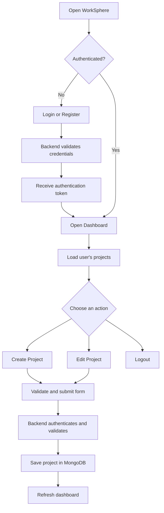

# WorkSphere

A full-stack project management application built using the **MEAN stack**. WorkSphere helps users manage projects through an authenticated dashboard, with project creation, editing, and a backend designed to support future task management and team collaboration.

**Project status:** 🚧 Actively in development

## Table of Contents

- [Overview](#overview)
- [Technology Stack](#technology-stack)
- [Implemented Features](#implemented-features)
- [Application Flow](#application-flow)
- [Project Management Flow](#project-management-flow)
- [Architecture](#architecture)
- [API Overview](#api-overview)
- [Validation and Error Handling](#validation-and-error-handling)
- [Testing](#testing)
- [Getting Started](#getting-started)
- [Roadmap](#roadmap)

## Overview

WorkSphere is a full-stack application built to provide a foundation for project planning and management. It combines an Angular frontend, a Node.js and Express backend, and MongoDB for data storage.

The application currently supports user authentication and project management. Authenticated users can access their dashboard, view their projects, create new projects, and edit existing projects.

The project is being developed incrementally, with a focus on clean code organization, API validation, secure access control, automated testing, and a responsive user experience.

## Technology Stack

### Frontend
- **Angular 22** — standalone component-based application
- **TypeScript** — type-safe development
- **Angular Reactive Forms** — form handling and validation
- **Angular Router** — navigation and route protection
- **Angular HttpClient** — communication with backend APIs
- **Vitest** — frontend unit testing

### Backend
- **Node.js** — JavaScript runtime
- **Express 5** — REST API framework
- **TypeScript** — type-safe backend development
- **MongoDB Node.js Driver 6** — database operations
- **JSON Web Tokens (JWT)** — authentication
- **Automated backend tests** — API and service-level verification

### Database
- **MongoDB 5.0** — document-oriented database

### Development Tools
- Git and GitHub for version control
- npm for package management
- Angular build tooling
- Local development proxy for frontend API requests

## Implemented Features

### 1. User Authentication

- User registration and login.
- JWT-based authentication.
- Protected backend API routes.
- Angular authentication service and HTTP interceptor.
- Route guard for restricting access to protected pages.
- Logout functionality.
- Authorization headers attached to authenticated API requests.

**Current limitation:** Authentication state is maintained in memory on the frontend. Persistent login across browser refreshes has not yet been implemented.

### 2. Project Management

#### View Projects
- Display the authenticated user's projects on the dashboard.
- Support paginated project retrieval through the backend API.
- Display project information and status.
- Handle loading, empty, and error states.
- Retry loading when a request fails.

#### Create Projects
- Open a project creation form from the dashboard.
- Enter a project name and description.
- Select a project status.
- Optionally provide start and due dates.
- Validate the form before submitting.
- Display saving and error feedback.
- Refresh the project list after successful creation.

#### Edit Projects
- Open an existing project's edit form.
- Prepopulate the form with the project's current information.
- Update project details and status.
- Validate required fields and date ordering.
- Cancel editing without saving changes.
- Refresh the project list after successful updates.

### 3. Backend Project API

- Create, retrieve, update, and delete projects through REST endpoints.
- Restrict project access to authenticated users.
- Enforce project ownership on backend operations.
- Validate incoming project data.
- Validate MongoDB ObjectIds.
- Support paginated project retrieval.
- Validate start and due date ordering.
- Return structured error responses.

The backend supports project deletion through its API; a corresponding dashboard deletion workflow is not yet documented as implemented.

### 4. Backend Health Checks

- Health endpoint for checking service availability.
- Readiness endpoint for checking whether the backend is ready to handle requests.

### 5. Testing and Build Verification

- Automated backend tests.
- Frontend component and service tests.
- Tests for project creation and editing requests.
- Tests for form validation, cancellation, successful saves, and API errors.
- Build verification for the frontend and backend.

## Application Flow



### Authentication Flow

1. A user registers or enters their login credentials.
2. The frontend sends the request to the backend.
3. The backend validates the request and handles authentication.
4. A successful login returns an authentication token.
5. The frontend uses the token for authenticated API requests.
6. The route guard and backend authentication middleware protect restricted functionality.
7. The user can log out from the dashboard.

### Dashboard Flow

1. The authenticated user opens the dashboard.
2. The frontend requests the user's projects.
3. The backend checks authentication and project ownership.
4. The project list is returned to the frontend.
5. The dashboard displays the results or the appropriate loading, empty, or error state.
6. The user can create or edit a project and see the refreshed list after a successful save.

## Project Management Flow

### Creating a Project

1. Select **New Project**.
2. Enter the project details.
3. Complete the required fields.
4. Submit the form.
5. The frontend validates the data.
6. The backend validates the request and saves the project.
7. The dashboard refreshes to display the new project.

### Editing a Project

1. Select the edit action for a project.
2. Review the prefilled project details.
3. Modify the required fields.
4. Submit the changes.
5. The backend verifies access and validates the update.
6. The updated project is saved.
7. The dashboard refreshes with the latest project information.

### Cancelling an Edit

1. Open the create or edit form.
2. Select **Cancel**.
3. The form closes without submitting the changes.

## Architecture

WorkSphere follows a frontend/backend separation.

```text
WorkSphere
│
├── frontend/
│   └── Angular application
│       ├── Core services and models
│       ├── Authentication
│       ├── Route guards and HTTP interceptor
│       └── Dashboard and project forms
│
├── backend/
│   └── Express application
│       ├── API routes
│       ├── Controllers and services
│       ├── Authentication and authorization
│       ├── Request validation
│       └── MongoDB access
│
└── README.md
```

### Request Lifecycle

1. Angular sends an HTTP request to an API endpoint.
2. The development proxy forwards `/api` requests to the backend running on port `3000`.
3. Express routes the request to the appropriate handler.
4. Authentication, authorization, and validation are applied where required.
5. The backend performs the relevant database operation.
6. The API returns a response to the frontend.
7. Angular updates the user interface based on the result.

## API Overview

The following project endpoints are implemented:

| Method | Endpoint | Purpose |
|---|---|---|
| `GET` | `/api/health` | Check backend health |
| `GET` | `/api/ready` | Check backend readiness |
| `POST` | `/api/projects` | Create a project |
| `GET` | `/api/projects` | Retrieve the authenticated user's projects |
| `PUT` | `/api/projects/:projectId` | Update a project |
| `DELETE` | `/api/projects/:projectId` | Delete a project |

Authentication endpoints support user registration and login. Refer to the backend route definitions for their exact paths and request payloads.

Project endpoints require authentication. Project operations enforce ownership so a user cannot access or modify another user's project without authorization.

## Validation and Error Handling

WorkSphere includes validation and feedback at both frontend and backend levels.

- Project names are required, trimmed, and limited to 100 characters.
- Project descriptions are limited to 2,000 characters.
- Due dates cannot precede start dates when both dates are supplied.
- Invalid identifiers and project data are rejected by the backend.
- Unauthorized requests are restricted.
- The frontend prevents duplicate submissions while saving.
- Loading, empty, success, and error states provide feedback to the user.

## Testing

Run the frontend checks from the `frontend` directory:

```powershell
npm test -- --watch=false
npm run build
```

Run the backend tests and build from the `backend` directory using the test and build scripts defined in its `package.json`.

The frontend test suite and build have passed during development. The frontend build currently reports a component stylesheet budget warning; this does not prevent the build from succeeding.

## Getting Started

### Prerequisites

- Node.js and npm
- MongoDB running locally or an appropriately configured MongoDB instance
- Git

### 1. Clone the repository

```powershell
git clone https://github.com/jisnajoseph27/worksphere-mean-project-management.git
cd worksphere-mean-project-management
```

### 2. Install dependencies

Install the frontend and backend dependencies separately:

```powershell
cd backend
npm install
```

```powershell
cd ..\frontend
npm install
```

### 3. Configure the backend

Configure the MongoDB connection and other required environment variables according to the backend configuration and example environment file, if provided. Keep credentials and secrets out of version control.

### 4. Start the backend

From the `backend` directory, use the development or start script defined in `backend/package.json`. The frontend development proxy expects the backend at:

```text
http://localhost:3000
```

### 5. Start the frontend

Open a separate terminal:

```powershell
cd frontend
npm start
```

Open the local URL printed by Angular in the terminal.

## Roadmap

The following features are planned or remain to be developed.

- [ ] Project Details page
- [ ] Task creation, editing, assignment, and status tracking
- [ ] Team member management and project assignments
- [ ] Role-based access control with defined user roles and permissions
- [ ] Project progress and analytics dashboard
- [ ] Activity tracking and project history
- [ ] Improved authentication persistence and session handling
- [ ] Project deletion workflow in the frontend
- [ ] Expanded automated testing and end-to-end coverage
- [ ] UI refinements, accessibility improvements, and responsive design enhancements

## Project Status

🚧 **Work in progress.**

WorkSphere currently provides authentication, a protected project dashboard, project listing, and project creation and editing. The application is being expanded incrementally toward a more complete project and task management platform.

## Repository

GitHub: https://github.com/jisnajoseph27/worksphere-mean-project-management
